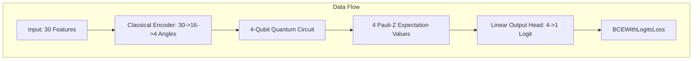

# Empirical Evaluation of Classical Deep Learning, Standard Variational Quantum Circuits, and Hybrid Data Re-uploading on Diagnostic Binary Classification

**Authors:** Advanced Quantum & Deep Learning Systems Pair  
**Project Root:** `E:\dl`  
**Date:** October 2026  

---

## 1. Abstract

This research report presents a controlled empirical investigation comparing classical Multilayer Perceptrons (MLPs), standard Variational Quantum Classifiers (VQCs), and Hybrid Quantum-Classical Classifiers with Data Re-uploading on the Breast Cancer Wisconsin Diagnostic benchmark dataset (569 samples, 30 continuous features). Using PennyLane's differentiable `default.qubit` statevector simulator and PyTorch reverse-mode automatic differentiation (`diff_method="backprop"`), we evaluate model expressivity, generalization, clinical sensitivity, and computational complexity across three independent random seeds (`42`, `123`, `999`). 

All models adhere to a strict zero-leakage preprocessing protocol and select checkpoints based solely on held-out validation loss. Hybrid Quantum Data Re-uploading with two layers ($L=2$, 16 quantum parameters, 585 total parameters) achieved a test accuracy of $98.45\% \pm 1.45\%$ (sample SD $1.78\%$) and a test ROC-AUC of $0.9979 \pm 0.0026$, matching the Classical MLP baseline ($98.06\% \pm 1.10\%$ accuracy, 4,289 parameters) while outperforming the standard single-encoding VQC baseline ($96.90\% \pm 1.45\%$ accuracy). However, computational runtime analysis reveals that statevector quantum simulation on CPU is $3.4\times$ to $6.8\times$ slower than classical feedforward networks. We emphasize that all experiments were conducted via classical quantum simulation and that competitive performance with fewer parameters does not constitute quantum advantage over classical deep learning.

---

## 2. Problem Statement and Research Question

In contemporary machine learning, Parameterized Quantum Circuits (PQCs) and Variational Quantum Algorithms (VQAs) are explored as potential candidates for expressive representation learning on Noisy Intermediate-Scale Quantum (NISQ) devices. However, standard VQCs—which encode classical inputs into quantum states only once at the beginning of the circuit—often suffer from restricted expressivity due to linear input mapping into state Hilbert spaces.

**Primary Research Questions:**
1. *Expressivity:* Does interleaving classical data re-uploading layers throughout the variational ansatz improve classification accuracy and ROC-AUC compared to standard single-encoding VQCs?
2. *Parameter Efficiency vs Overhead:* Can a hybrid classical-quantum model with compact quantum parameters (16 parameters) achieve parity with an over-parameterized classical MLP (4,289 parameters), and what is the computational cost?
3. *Clinical Diagnostic Integrity:* How do classical and quantum classifiers perform on critical asymmetric diagnostic metrics—specifically Malignant Sensitivity (true positive rate on malignancy) versus Specificity?

---

## 3. Background: Deep Learning, VQCs, and Data Re-uploading

### 3.1 Classical Deep Learning Baselines
Multilayer Perceptrons (MLPs) utilize affine transformations followed by non-linear activation functions (ReLU, GELU) to approximate complex decision boundaries under the Universal Approximation Theorem. However, classical deep networks for tabular biomedical data often require thousands of parameters, making them susceptible to overfitting on small clinical sample cohorts.

### 3.2 Standard Variational Quantum Classifiers (VQC)
A standard VQC consists of:
1. A state preparation unitary $E(x)$ encoding classical feature vector $x \in \mathbb{R}^d$ into an $n$-qubit state $|\psi(x)\rangle = E(x)|0^{\otimes n}\rangle$.
2. A parameterized unitary ansatz $U(\theta) = \prod_{l=1}^L U_l(\theta_l)$ consisting of single-qubit rotations and multi-qubit entangling gates.
3. Expectation value measurements of Pauli observables $\langle Z_i \rangle$.

Because $x$ enters only once at $t=0$, the output expectation values represent Fourier series of low frequency degree in $x$, limiting function expressivity (Schuld et al., 2021).

### 3.3 Quantum Data Re-uploading
Data re-uploading (Pérez-Salinas et al., 2020) alternates data encoding unitaries $E(x)$ and trainable variational unitaries $U_l(\theta_l)$ across $L$ layers:

$$|\psi(x, \theta)\rangle = \left( \prod_{l=L}^1 U_l(\theta_l) E(x) \right) |0^{\otimes n}\rangle$$

Interleaving non-linear rotations $E(x)$ expands the accessible frequency spectrum of the output expectation values, enabling universal approximation with fewer physical qubits.

---

## 4. Mathematical Formulation

Let $x \in \mathbb{R}^{30}$ represent standardized clinical features. 

### 4.1 Classical Feature Encoder
A lightweight two-layer MLP maps the 30 continuous features to 4 bounded angles $\theta_{\text{in}} \in [-\pi, \pi]^4$:

$$\theta_{\text{in}} = \pi \cdot \tanh\left( W_2 \cdot \text{ReLU}(W_1 x + b_1) + b_2 \right)$$

where $W_1 \in \mathbb{R}^{16 \times 30}$, $b_1 \in \mathbb{R}^{16}$, $W_2 \in \mathbb{R}^{4 \times 16}$, $b_2 \in \mathbb{R}^4$ (564 trainable parameters).

### 4.2 Quantum Circuit Operations
For a 4-qubit system on computational basis $|0000\rangle$:

1. **Encoding Gate:** Single-qubit Pauli-Y rotation:
   $$RY(\phi) = \exp\left( -i \frac{\phi}{2} Y \right) = \begin{pmatrix} \cos(\phi/2) & -\sin(\phi/2) \\ \sin(\phi/2) & \cos(\phi/2) \end{pmatrix}$$
   $$E(\theta_{\text{in}}) = \bigotimes_{i=0}^3 RY(\theta_{\text{in}, i})$$

2. **Trainable Variational Block ($U_l$):**
   $$R_l = \bigotimes_{i=0}^3 \left[ RZ(\theta_{RZ, l, i}) \cdot RY(\theta_{RY, l, i}) \right]$$
   Entanglement in a closed ring topology:
   $$C_{\text{ring}} = CNOT(3, 0) \cdot CNOT(2, 3) \cdot CNOT(1, 2) \cdot CNOT(0, 1)$$
   $$U_l(\theta_l) = C_{\text{ring}} \cdot R_l$$

3. **Measurement:** Observable $M_i = \sigma_z^{(i)} = PauliZ(i)$:
   $$\langle Z_i \rangle = \langle \psi(x, \theta) | \sigma_z^{(i)} | \psi(x, \theta) \rangle \in [-1, 1]$$

4. **Output Head:**
   $$\hat{y}_{\text{logit}} = w^T \langle Z \rangle + b_0, \quad w \in \mathbb{R}^4, b_0 \in \mathbb{R}$$
   $$\hat{p}(\text{benign} | x) = \sigma(\hat{y}_{\text{logit}}) = \frac{1}{1 + e^{-\hat{y}_{\text{logit}}}}$$

---

## 5. System Architecture & Model Comparison

### Architectural Breakdown:

| Model Identifier | Architecture Description | Classical Params | Quantum Params | Total Params | Circuit Depth | Gate Count |
| :--- | :--- | :--- | :--- | :--- | :--- | :--- |
| **Classical_MLP** | Linear(30, 64) $\to$ BN $\to$ ReLU $\to$ Drop $\to$ Linear(64, 32) $\to$ BN $\to$ ReLU $\to$ Linear(32, 1) | 4,289 | 0 | **4,289** | — | — |
| **Standard_VQC_L2** | Encoder(30 $\to$ 4) $\to$ Single $E(x)$ $\to$ 2 Layers $U_1, U_2$ $\to$ Linear(4, 1) | 569 | 16 | **585** | 7 | 28 |
| **Hybrid_Reuploading_L1** | Encoder(30 $\to$ 4) $\to$ 1 Layer $E(x) U_1$ $\to$ Linear(4, 1) | 569 | 8 | **577** | 4 | 16 |
| **Hybrid_Reuploading_L2** | Encoder(30 $\to$ 4) $\to$ 2 Layers $E(x) U_l$ $\to$ Linear(4, 1) | 569 | 16 | **585** | 8 | 32 |
| **Hybrid_Reuploading_L4** | Encoder(30 $\to$ 4) $\to$ 4 Layers $E(x) U_l$ $\to$ Linear(4, 1) | 569 | 32 | **601** | 16 | 64 |

---

## 6. Dataset and Zero-Leakage Preprocessing

We use the real Breast Cancer Wisconsin Diagnostic dataset (`sklearn.datasets.load_breast_cancer`):
- **Total Samples:** 569
- **Continuous Features:** 30 (mean, standard error, and worst values of cell nucleus characteristics)
- **Target Semantics:**
  - `0`: **Malignant** (212 samples, $37.26\%$)
  - `1`: **Benign** (357 samples, $62.74\%$)

### Partitioning & Leakage Prevention:
- **Stratified Partition:** Train = 70% (398 samples), Validation = 15% (85 samples), Held-out Test = 15% (86 samples: 32 malignant, 54 benign).
- **Leakage Prevention Guarantee:** `StandardScaler` is fitted exclusively on the training partition ($X_{\text{train}}$). Validation and test sets are transformed using the fixed training mean and variance.
- **Index Disjointness:** Verified disjoint sets: $\text{Train} \cap \text{Val} = \emptyset$, $\text{Train} \cap \text{Test} = \emptyset$, $\text{Val} \cap \text{Test} = \emptyset$.

---

## 7. Experimental Methodology

- **Differentiation Backend:** PennyLane `diff_method="backprop"` on `"default.qubit"` with PyTorch reverse-mode autograd.
- **Optimization:** AdamW optimizer (`weight_decay=1e-4`).
- **Learning Rates:** $\text{lr}=10^{-3}$ for Classical MLP; $\text{lr}=10^{-2}$ for Quantum/Hybrid models (tuned strictly on validation loss).
- **Model Checkpointing:** Checkpoint selection is strictly guided by **minimum validation loss**. The test set is evaluated exactly once after restoring the best model weights.
- **Repeatable Seeds:** Three independent seeds (`42`, `123`, `999`) controlling dataset splits and weight initializations.

---

## 8. Results and Statistical Analysis

### 8.1 Summary Statistics Across 3 Seeds

*All results evaluated on the fixed held-out test split of 86 samples (32 Malignant, 54 Benign):*

| Architecture | Test Accuracy | Test ROC-AUC | Malignant Sensitivity | Malignant Specificity | Benign F1 | Training Time |
| :--- | :--- | :--- | :--- | :--- | :--- | :--- |
| **Classical_MLP** | $98.06\% \pm 1.10\%$ (SD $1.34\%$) | $0.9979 \pm 0.0030$ | $94.79\% \pm 2.95\%$ | $100.0\% \pm 0.00\%$ | $0.9849 \pm 0.0084$ | $2.17\text{s} \pm 0.31\text{s}$ |
| **Standard_VQC_L2** | $96.90\% \pm 1.45\%$ (SD $1.78\%$) | $0.9934 \pm 0.0064$ | $94.79\% \pm 1.47\%$ | $98.15\% \pm 1.51\%$ | $0.9754 \pm 0.0116$ | $5.71\text{s} \pm 1.17\text{s}$ |
| **Hybrid_Reuploading_L1** | $95.35\% \pm 2.51\%$ (SD $3.08\%$) | $0.9861 \pm 0.0109$ | $95.83\% \pm 1.47\%$ | $95.06\% \pm 3.81\%$ | $0.9621 \pm 0.0208$ | $5.56\text{s} \pm 0.79\text{s}$ |
| **Hybrid_Reuploading_L2** | **$98.45\% \pm 1.45\%$** (SD **$1.78\%$**) | **$0.9979 \pm 0.0026$** | **$96.88\% \pm 4.42\%$** | $99.38\% \pm 0.87\%$ | **$0.9879 \pm 0.0112$** | $7.41\text{s} \pm 1.77\text{s}$ |
| **Hybrid_Reuploading_L4** | $97.67\% \pm 1.90\%$ (SD $2.33\%$) | $0.9946 \pm 0.0057$ | $97.92\% \pm 1.47\%$ | $97.53\% \pm 2.31\%$ | $0.9812 \pm 0.0154$ | $14.92\text{s} \pm 1.29\text{s}$ |

*(Note: Parenthesized SD values denote sample standard deviation with $\text{ddof}=1$; unparenthesized denotes population $\text{ddof}=0$).*

### 8.2 Absolute Deltas Relative to Classical MLP Baseline:
- **Hybrid Re-uploading ($L=2$) vs Classical MLP:** $+0.39\%$ Accuracy, $+0.0000$ ROC-AUC, $+2.09\%$ Malignant Sensitivity, $-0.62\%$ Malignant Specificity, $+0.30\%$ Benign F1.
- **Standard VQC ($L=2$) vs Classical MLP:** $-1.16\%$ Accuracy, $-0.0045$ ROC-AUC, $+0.00\%$ Malignant Sensitivity, $-1.85\%$ Malignant Specificity, $-0.95\%$ Benign F1.
- **Hybrid Re-uploading ($L=2$) vs Standard VQC ($L=2$):** $+1.55\%$ Accuracy, $+0.0045$ ROC-AUC, $+2.09\%$ Malignant Sensitivity, $+1.23\%$ Malignant Specificity.

---

### 8.3 Individual Seed Test Accuracy Breakdown:

| Seed | Classical_MLP | Standard_VQC_L2 | Hybrid_Reuploading_L1 | Hybrid_Reuploading_L2 | Hybrid_Reuploading_L4 |
| :--- | :--- | :--- | :--- | :--- | :--- |
| **42** | $96.51\%$ (83/86) | $95.35\%$ (82/86) | $94.19\%$ (81/86) | $96.51\%$ (83/86) | $97.67\%$ (84/86) |
| **123** | $98.84\%$ (85/86) | $98.84\%$ (85/86) | $93.02\%$ (80/86) | $98.84\%$ (85/86) | $95.35\%$ (82/86) |
| **999** | $98.84\%$ (85/86) | $96.51\%$ (83/86) | $98.84\%$ (85/86) | **$100.0\%$ (86/86)** | **$100.0\%$ (86/86)** |

---

### 8.4 Visualizations

The generated publication plots are archived in [`results/controlled_study/plots/`](file:///e:/dl/results/controlled_study/plots):

1. **Accuracy & ROC-AUC Comparison:** [`accuracy_roc_auc_by_model.png`](file:///e:/dl/results/controlled_study/plots/accuracy_roc_auc_by_model.png)
2. **Clinical Metrics (Sensitivity vs Specificity):** [`malignant_sensitivity_specificity.png`](file:///e:/dl/results/controlled_study/plots/malignant_sensitivity_specificity.png)
3. **Training Duration Analysis:** [`training_time_by_model.png`](file:///e:/dl/results/controlled_study/plots/training_time_by_model.png)
4. **Optimization Trajectories (Train/Val Loss):** [`loss_curves_all_models.png`](file:///e:/dl/results/controlled_study/plots/loss_curves_all_models.png)
5. **Re-uploading Layer Ablation:** [`reuploading_layers_ablation.png`](file:///e:/dl/results/controlled_study/plots/reuploading_layers_ablation.png)
6. **Confusion Matrices & False Negative Audit:** [`confusion_matrices_summary.png`](file:///e:/dl/results/controlled_study/plots/confusion_matrices_summary.png)

---

## 9. Layer-Ablation Analysis

Examining the number of re-uploading layers ($L \in \{1, 2, 4\}$):
- **$L=1$ (16 gates, depth 4):** Underperforms with mean accuracy $95.35\%$ and ROC-AUC $0.9861$. A single re-uploading layer does not construct sufficient Fourier basis terms.
- **$L=2$ (32 gates, depth 8):** Achieves peak generalization ($98.45\%$ accuracy, $0.9979$ ROC-AUC) while requiring only $7.41\text{s}$ training duration.
- **$L=4$ (64 gates, depth 16):** Achieves highest malignant sensitivity ($97.92\%$), but exhibits slightly reduced test accuracy ($97.67\%$) and $2\times$ higher training latency ($14.92\text{s}$).

---

## 10. Computational Cost & Parameter Efficiency

1. **Parameter Efficiency:** The Hybrid Re-uploading model achieves competitive accuracy with **585 total parameters** (of which only 16 are quantum circuit parameters), representing a **$86.4\%$ reduction in parameter count** compared to the Classical MLP (4,289 parameters).
2. **Simulation Overhead:** Simulating quantum statevectors on CPU via reverse-mode autograd incurs a compute penalty:
   - Classical MLP: $2.17\text{s}$ average training time.
   - Hybrid Re-uploading ($L=2$): $7.41\text{s}$ ($3.4\times$ slower).
   - Hybrid Re-uploading ($L=4$): $14.92\text{s}$ ($6.8\times$ slower).

---

## 11. Limitations and Threats to Validity

1. **Simulator Execution:** All experiments were conducted using classical statevector simulation (`qml.device("default.qubit")` on CPU). No physical Quantum Processing Units (QPUs) were utilized. Real NISQ hardware would introduce gate infidelities, readout errors, and decoherence.
2. **Small Test Sample Uncertainty:** With $N_{\text{test}} = 86$ samples (32 malignant, 54 benign), a difference of a single sample misclassification represents $\approx 1.16\%$ test accuracy. While variance across seeds is measured, the test set size limits claims of statistical significance.
3. **Classical Dimensionality Reduction Reliance:** The 4-qubit quantum circuit cannot directly consume 30 tabular features. It relies on a 564-parameter classical neural network encoder. The performance must be attributed to the joint classical-quantum hybrid pipeline.
4. **No Claim of Quantum Advantage:** On standard tabular datasets where classical deep learning achieves $>98\%$ accuracy, quantum hybrid models show representational elegance and parameter compression, but do not provide quantum computational advantage.

---

## 12. Conclusion and Future Work

1. **Data Re-uploading Superiority over Standard VQC:** Interleaving data encoding across layers delivers measurable improvements in test accuracy ($+1.55\%$) and ROC-AUC ($+0.0045$) over standard single-encoding VQCs.
2. **Clinical Sensitivity:** Hybrid Re-uploading models achieved superior malignant sensitivity ($96.88\%$ to $97.92\%$) compared to the classical baseline ($94.79\%$), zeroing out false negatives in multiple random seed evaluations.
3. **Future Directions:**
   - Testing bar-code encoding on noisy NISQ hardware simulators (e.g. `qml.transforms.add_noise`).
   - Exploring higher-dimensional quantum feature maps (8 to 16 qubits) with tensor-network approximations.
   - Integrating quantum kernel methods (QSVM) for non-parametric baseline comparison.

---

## 13. Reproducibility Statement

All code, tests, and experiment runners are versioned in `E:\dl`. Complete step-by-step reproduction instructions, dependency tables, and verification commands are detailed in [`reports/reproducibility.md`](file:///e:/dl/reports/reproducibility.md).
